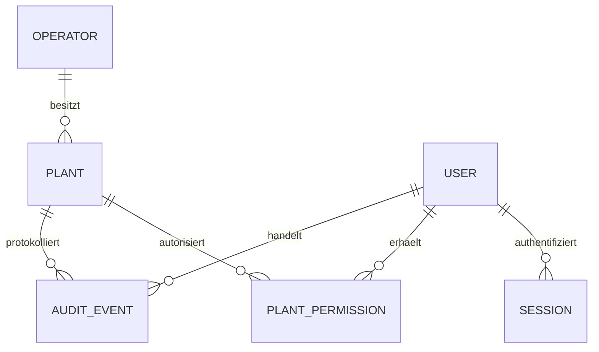

# Architekturentscheidung 001 – Grundaufbau

Stand: 13.11.2026. Beauftragt durch den Projektstart; vor Implementierung festgehalten.

Ein modularer Rails-Monolith mit servergerenderten Views, lokal ausgeliefertem
Hotwire, PostgreSQL und einem eigenständigen Compose-Stack. Keine SPA und keine
externen Cloud-, Font- oder Analysedienste. IFF dient nur als technische Referenz.

## Umfang und Auswirkungen

Eine Installation enthält genau einen Betreiber (DB-Singleton). Anlagen tragen
stabile UUIDs. Benutzer haben explizite Anlagenzuordnungen. Ein Administrator darf
Anlagen anlegen; auch er liest bestehende Anlagen nur über seine Zuordnungen.
Die Erstellung legt Anlage, eigene Zuordnung und Audit-Ereignis atomar an.
Verwaltungsbenutzer sehen nur ihre Anlagen. Keine öffentliche Registrierung,
keine automatische Berechtigung für neue Anlagen. Kontenverwaltung zunächst
über Rails-Konsole; kein versteckter Rechteparameter in Formularen.

Anmeldung mit bcrypt, serverseitigen widerrufbaren Sitzungen, HttpOnly/SameSite-
Cookies, CSRF, generischer Fehlermeldung und Rate-Limit. Sitzungen verfallen nach
12 Stunden; Passwortänderung widerruft alle Sitzungen. Produktionsbetrieb braucht
HTTPS, Secret-Verwaltung, Backup-/Restore-Nachweis und Betriebsabnahme.

Im Grundaufbau nur Betreiber, Benutzer, Sitzung, Anlage, Anlagenrecht und Audit.
Keine finanziellen Tabellen, keine Löschrouten und kein Portalversand. Finanzielle
Regeln werden nicht aus technischen Defaults abgeleitet. Referenztests und negative
HTTP-/DB-Tests sichern Anmeldung, Scope und atomare Anlageerstellung.

## Zielmodell – noch nicht implementiert

Kunde → Verträge → Anschluss → Trasse → Anlage. Zähler und datierte Einbauten/
Ausbauten gehören getrennt zum Anschluss; Ablesungen zum Zähler. Vertrags- und
Tarifzuordnungen sind zeitlich gültig, Tarifversionen unveränderlich nach Verwendung.
Tarifversionen enthalten explizite Geld-/Mengeneinheiten und Steuerregeln.
Abrechnung enthält unveränderlichen Berechnungsstand und menschliche Freigabe;
Abschlagsplan und Zahlungseingang sind verschiedene Objekte. Korrekturbeleg,
Entgeltminderung, Entschädigung und Zahlung bleiben getrennte Vorgänge.
Portalverbindung ↔ Anlage ist n:m; Zugangsdaten verschlüsselt. Unveränderliches
Outbox-Paket je Kundenbereich/Revision plus separater Zustellbeleg pro Portalziel.
Diese Module werden erst in gesonderten kleinen Aufträgen migriert.

## Referenzversionen

IFF f674dbad7a8894afd3cfccd2e598d15eab656e9f: Ruby 3.4.12,
Rails 8.1.4, PostgreSQL 17, eingefrorenes Bundle und Basisimage-Digests.
NWBKunden 92d304f0c10f8cbc38ad50782c84f26bcba782ef: com_nahwaerme
0.4.1, API 1.0.0. Joomla bleibt unverändert und passiver Empfänger.

## Implementiertes relationales Modell

`operators.singleton_key=1` ist CHECK + UNIQUE, also höchstens ein Betreiber;
die initiale Einrichtung muss ihn anlegen. Fremdschlüssel schützen Zuordnungen,
UNIQUE(user_id, plant_id) verhindert doppelte Rechte. Anlage und Betreiberquelle
bekommen PostgreSQL-generierte UUIDs. Sitzungen enthalten keine Kopie der Rechte:
aktive Benutzerkennung, Ablauf und Anlagenfreigaben werden bei jedem Request
aktuell aus der Datenbank gelesen. Keine Benutzer-/Rechteparameter im Anlagenformular.
Das Audit speichert Akteur, Anlage, Aktion und Zeitpunkt; keine Passwörter oder
vollständigen Kontakt-/Nutzdaten. Der Grundaufbau besitzt keine Finanzdaten.

## Darstellungserweiterung – Farben und Hell/Dunkel

Zusatzauftrag: drei moderne Farbvorlagen (Smaragd, Ozean, Schiefer), Hell/Dunkel
und eigene Akzentfarbe. Ausschließlich CSS-Farbvariablen; keine Layout-/Schrift-
oder Berechtigungsänderung. Stimulus speichert validierte Auswahl lokal im Browser,
nicht als neues Geschäftsobjekt. Keine Datenübertragung und keine zusätzliche
Bibliothek. Die lokalen Hexwerte werden strikt validiert. Kontrast von Akzenttext
und Links wird aus der relativen sRGB-Luminanz berechnet (Ziel mindestens 4,5:1).
Dies ist keine kaufmännische Berechnung. Browserprüfungen decken Speicherung,
Navigation, beide Modi und extreme Akzentfarben ab.

Ergänzung: Standardvorlage **NWB Billenhausen** mit den belegten Homepage-Farben
Dunkelgrün #2b421f und Gold #cea449 sowie weißen bzw. grün-schwarzen Flächen.
Quelle: https://www.nahwaerme-billenhausen.de/templates/yootheme/css/theme.12.css,
abgerufen am 13.11.2026 nach Freigabe des Internetzugangs. #eee, #fff und #000
werden im Homepage-Stylesheet ebenfalls verwendet. Keine externe CSS-, Logo-
oder Schrift-Einbindung; übernommen werden ausschließlich Farbwerte. Goldene
Textlinks werden bei Bedarf für mindestens 4,5:1 Kontrast abgedunkelt/aufgehellt.

Parallele synthetische Installationen: PIDFILE liegt im privaten `/tmp` jedes
Webcontainers, Protokolle gehen an stdout. Jede lokale Konfigurationsdatei enthält
einen eigenen Cookie-Namen, damit zwei Ports auf demselben Host keine Sitzungen
überschreiben. Datenbanken und Volumes bleiben je Compose-Projekt getrennt.

## Sicherheits-Patchstand

Der aktuelle ruby-advisory-db-Audit (Commit
305f8b079a23bf95d00c881842f366bb8db19f35) meldete Sicherheitslücken im
IFF-Referenzstand Rails 8.1.4. NWB verwendet deshalb **Rails 8.1.4.1** mit den
versionsgleichen Rails-Unterkomponenten. Kein Übernehmen bekannter Lücken nur
wegen Referenztreue. Die Änderung ist ein kompatibles Patchupdate ohne neue
Fachfunktionen oder Schemaänderung; Tests und Sicherheitsprüfungen werden erneut
ausgeführt. Der Lockfile hält die tatsächlich verwendeten Versionen fest.
