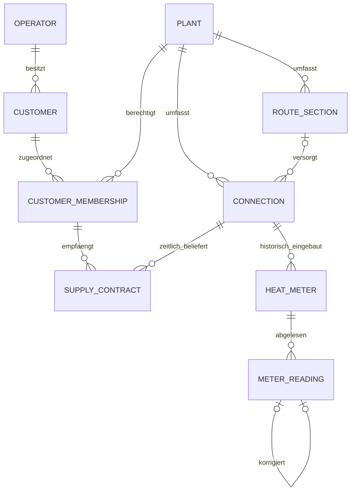

# Architekturentscheidung 002 – Stammdaten

Auftrag: docs/BRIEF_02.md. Additive Erweiterung; bestehende UUIDs, Konten,
Anlagen, Berechtigungen, Seeds und historische Daten bleiben erhalten.

## Entscheidungen vor Implementierung

- Kunde ist betreiberweit einmalig (UUID), Anlagenzuordnung separat mit optionaler
  Kundennummer, Zahlungsart, Lastschriftkennzeichen und Aktivstatus. Nummern sind
  innerhalb einer Anlage eindeutig, anlagenübergreifend dürfen sie gleich sein.
  Kontakt-/Adressdaten bleiben im Kundenobjekt. Keine Suche über fremde Anlagen.
- Gemeinsame Kontaktstammdaten dürfen nur Benutzer bearbeiten, die alle Anlagen
  dieses Kunden sehen dürfen. Die anlagenspezifische Zuordnung bleibt für dort
  Berechtigte bearbeitbar. Die Oberfläche verrät keine fremden Anlagennamen.
- Neue Zuordnungen vorhandener Kunden sind nur aus bereits sichtbaren Kunden
  auswählbar. Keine Suche nach fremden IDs oder E-Mail-Adressen zum Verknüpfen.
- Trasse, Anschluss, Zähler, Ablesung und Vertrag bekommen stabile UUIDs.
  Fremdschlüssel mit Anlagen-/Anschlussbezug verhindern fremde Zuordnungen auch
  bei direkten DB-Schreibzugriffen. Es wird kein Portalclient ergänzt.
- Verträge sind die einzige zeitliche Kundenzuordnung zum Anschluss. Beginn und
  Ende gelten einschließlich. Aktive und beendete Hauptverträge dürfen sich
  zeitlich nicht überlappen; Entwürfe und stornierte Verträge liefern keine Wärme.
  Kunde und Anschluss eines gespeicherten Vertrags werden nicht umgehängt.
  Vertragsänderungen werden versioniert im bestehenden Audit protokolliert.
- Zähler messen hier ausschließlich Wärme in kWh oder MWh. Ein-/Ausbauintervalle
  gelten [Einbautag, Ausbautag); Schlussablesung am Ausbautag ist erlaubt. Damit
  ist der Ausbau und Neueinbau am selben Tag möglich. Einbau und Ausbau desselben
  Zählers müssen an verschiedenen Tagen liegen (offene Uhrzeitgranularität).
- PostgreSQL btree_gist und Ausschlussconstraints sichern Vertrags-/Zählerintervalle
  auch gegen konkurrierende Schreibzugriffe. Elternsperren serialisieren Abläufe.
  Die vorhandene PostgreSQL-17-Installation muss die Standardextension erlauben.
- Neue Zähler erfordern einen Anfangswert. Ausbau/Wechsel erfordert Schlusswert;
  neue Zähler erhalten einen eigenen Anfangswert, keine Verbrauchsschätzung.
- Zählerstände sind Decimal(20,6), nicht negativ, maximal sechs Nachkommastellen.
  Ein effektiver Wert je Zähler und Tag. Beliebig viele Zwischenablesungstage.
  Korrektur erzeugt einen neuen Datensatz mit Verweis auf den Vorgänger und Grund;
  nur dessen Ablösezeitpunkt wird gesetzt. Ursprüngliche Werte werden nie ersetzt.
  Rückgänge brauchen ausdrücklich die Art Korrektur und eine Begründung.
  Es erfolgt keine Verbrauchs-, Tarif-, Steuer- oder Jahresberechnung.
- Änderungen an Verträgen, Zählern und Ablesungen erhalten Benutzer, Zeitpunkt
  und Vorher-/Nachherwerte im geschützten Audit. Keine Löschrouten. Audit ist wie
  bisher kein Schutz gegen DB-Administratoren. Adressen/Notizen sind Datenbankinhalt,
  dürfen aber nicht in Standardlogs erscheinen: Parameterfilter und INFO-Level.
- Bedienung: Anlage → Kunden / Anschlüsse / Zähler / Verträge / Trassen; nur
  autorisierte Scope-Abfragen, gebundene Suchparameter, begrenzte Ergebnisse.

## Offene Fachfragen

Uhrzeiten für mehrere Wechsel desselben Zählers am selben Tag, Katalog der
Zahlungsarten, Sonderfälle wie Zählerüberlauf, weitere Messzwecke und die späteren
Tarif-/Freigaberegeln bleiben explizit offen. Rückgänge werden nicht automatisch
als Verbrauch interpretiert. Es gibt keine angenommene Zählerüberlaufformel.

## Auswirkungen

Neue Tabellen und optionale Auditspalten; kein Löschen oder Umdeuten alter Daten.
Neue Geschäftsobjekte werden nicht automatisch zu echten Kundendaten befüllt.
Die bestehenden synthetischen 3-/50-Anlagen-Seeds bleiben unverändert.

Anlagenberechtigte Mitarbeiter dürfen die Stammdaten ihrer Anlagen pflegen. Die
bestehende Administratorpflicht für das Anlegen neuer Anlagen bleibt bestehen.
Gemeinsame Kundendaten unterliegen zusätzlich der oben beschriebenen Prüfung
aller Zuordnungen. Es gibt keine neue Benutzerrolle oder Benutzerverwaltung.

